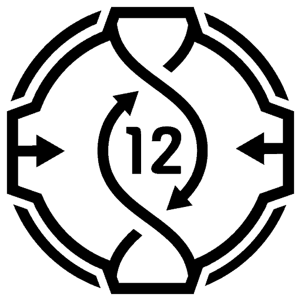

1)简介
本世界观基于SCP基金会进行二次创作，对于有借鉴的部分已经标出了原作（或其WIKI页面）。
这并非是一个典型的SCP风格设定。
代码部分使用了AI工具，具体来说是Deepseek，DeepseekHarness。我的版式很珍贵，拿走请写上是我和我的ai写的，拿我的token写的。
你大可以把它当作是我的自娱自乐。
祝你拥有美好的一天。:)

2)维护指南

*这一部分由AI维护！（Markdown你怎么这么坏）

多页面静态站点，纯 HTML/CSS/JS，无构建步骤、无依赖，双击就能开。

```
D:\DSH-WORK-CA\

├── index.html          ← 入口：模拟浏览器（收藏栏 / 搜索跳 Bing / 地址栏不可用）
├── foundation.html     ← 站点主页
├── archive.html        ← 异常项目列表
├── dossier.html        ← 档案详情【模板】（含 ACS 注释块，从卡片点进去的子页面）
├── scp9098.html        ← SCP-9098「晶骸，破碎的昔日」（含部件表 / 种别表 / 阶段阶梯 / 附录录音日记）
├── 9098A.html          ← 「当旧日分崩离析之时……」（沉坠区里的幸存者日志·完整版）
├── 9098c.html          ← 实验记录「该怎么去挣扎……」（宇航员日记）
├── scp9261.html        ← SCP-9261「幻境」（五张子空间卡，样式见 §16）
├── scp9347.html        ← SCP-9347「无常烬砂」（短条目，纯站内组件）
├── scp9926.html        ← SCP-9926「静待花开」（Thaumiel，含 15 条访谈）
├── scp9644b1.html      ← SCP-9644-B-1「侵蚀体」（**这条线的唯一入口**，归档列表里能看到）
├── scp9644b.html       ← SCP-9644-B（链上第二份，冷黑 O5 界面，样式在 o5.css）
├── scp9644.html        ← SCP-9644「苦难笼」【本体】崩坏版式（样式在 9644.css）
├── scp001.html         ← SCP-001 虚无的新生，存在的终焉（禁阅档案·特型版式）
├── scp20200.html       ← SCP-20200 禁忌的边境线Σ（站内绿色主题 + 爱蒂塔连接器界面）
├── q1280.html          ← 异常材料档案 Q1280 共相合金（站内绿色主题）
├── cff.html            ← 异常材料文档 混沌拟合液 CFF（参数仪表 + 危险提示）
├── scp181.html         ← SCP-181 幸运儿
├── scp912.html         ← SCP-912 自主型SWAT盔甲
├── scp2490.html        ← SCP-2490 Alpha-19
├── scp9279.html        ← SCP-9279 归潮（含照片背景的叙事附录）
├── mtf.html            ← MTF-Theta-11「The Pathfinders」单位档案 + **队员名册**
├── personnel.html      ← **相关人员档案**（小卡片索引，按势力分组）
├── a11.html            ← **Area-11 安保设施**（设施档案：分区表 + 常驻单位）
├── vh.html             ← POI-9926-1「记述人」（记录序列 + 逐级弱化的排比）
├── mtf-arctic.html     ← Arctic（指挥官）角色页
├── mtf-fallacy.html    ← Fallacy（火控员，即 SCP-079）角色页
├── mtf-acolyte.html    ← Acolyte（司铎）角色页
├── mtf-pulse.html      ← Pulse（生命维持专员）角色页
├── mtf-quasar.html     ← Quasar（战术火力与阵线构筑专员）角色页
├── mtf-drizzle.html    ← Drizzle（时序干涉专员）角色页
├── mtf-member.html     ← 队员档案【版式模板】（左立绘 + 右长文）
├── timeline.html       ← 时间线
├── tech.html           ← 技术与协议（索引：技术文档 / 条约协定）
├── tech-doc.html       ← 技术文档【版式模板】
├── tech-treaty.html    ← 条约协定【版式模板】
├── tr-001.html         ← 《协奏曲协议》（首个真条约文档）
├── scp000.html         ← SCP-000「织机」（**工业版式**：钢灰 + 蓝图网格 + 警示带）
├── pend.html           ← 处置协议：终末（同 SCP-000 的工业版式）
├── amber.html          ← MK. IX 琥珀套装（GOC 版式，放在技术与协议里）

├── oacm.html           ← O.A.C.M 技术白皮书（GOC 版式，长文）
├── area12.html         ← Area-12「极昼回廊」**SCP 项目档案**（白 + 红主题，首个用它的页面）
├── scp9354.html        ← SCP-9354「至纯至净的明天」（同样用 Area-12 主题，带 ACS）
├── ivory.html          ← 心智重构工程「象牙塔」（Area-12 的工程档案）
├── goc.html            ← GOC 威胁实体数据条目【版式模板】
├── goc9347.html        ← KTE-9347「调度员，安魂曲」（GOC 版式第一份实档）
├── goc9348.html        ← UTE-9348「调度员，礻」（含照片 + 毛玻璃的诗）
├── goc9349.html        ← UTE-9349「杀戮与守望之神」（含受污染文件节选）
├── assets/
│   ├── css/style.css   ← 站内唯一主样式表（绿色显像管世界）
│   ├── css/o5.css      ← 【第二套】冷黑高密级界面，给 scp9644b.html 用
│   ├── css/9644.css    ← 【第三套】红与黑 + 崩坏效果，给 scp9644.html 用
│   ├── css/loom.css    ← 【第六套】钢灰 + 琥珀，SCP-000 专用（工业版式）
│   ├── css/area12.css  ← 【第五套】白 + 红，覆盖 style.css 的配色（Area-12 主题）
│   ├── css/goc.css     ← 【第四套】深蓝 + 白 + 冷灰，给 goc.html 用
│   ├── js/site.js      ← 站内唯一脚本（CRT 开关 / 时钟 / 筛选等）
│   └── img/
│       ├── logo.png        ← 顶栏徽标（透明底 + 站点主色，128×120）
│       ├── logo-source.jpg ← 徽标源图（灰线黑底，留着以后改色重染）
│       ├── 9279-sea.jpg    ← SCP-9279 叙事附录的背景照片
│       ├── goc-emblem.png  ← GOC 徽标（256×256，白底裁圆用）
│       ├── 9348-reeds.jpg  ← UTE-9348 那段诗的底图（芦苇/长草剪影）
│       ├── area12-logo.png ← Area-12 徽标（512×512，白底 + multiply 用）
│       ├── logo-crimson.png ← 顶栏徽标的红色版本（Area-12 主题用）
│       ├── logo-amber.png   ← 徽标的琥珀版本（SCP-000 工业版式用）
│       └── logo-20200.png   ← 爱蒂塔计划徽标（256×256，SCP-20200 连接器界面用）
├── site00-game.html    ← 彩蛋：终端文字小游戏（独立，不参与站点链接）
├── tools/acs-reference.png  ← ACS 参考图
├── tools/tint-logo.py      ← 徽标染色脚本
├── preview(README用）/            ← 预览截图
└── README.md
```

- §1–§8 讲站点本体（各页面 + `assets/`）
- §9 讲入口页 `index.html`
- §10 讲小游戏 `site00-game.html`
- §11 讲 ACS 分级条
- §12 讲 SCP-001 那种特型版式
- §13 讲「苦难笼」故事线——三份串联的档案、两套额外样式、会崩坏的结尾
- §14 讲正文里的**内容型组件**（部件表 / 种别表 / 阶段阶梯）
- §15 讲**现场记录**这种"人写的东西"该怎么排（`9098A.html`）
- §16 讲**子空间条目**（`scp9261.html` 那种一张卡一个空间的图鉴）
- §17 讲**GOC 版式**（`goc.html` 深蓝 + 白 + 冷灰，跟站内四套视觉都不搭界）

> 行号会随着你编辑而偏移，所以下面定位代码一律用**搜索关键字**，不用行号。

---

## 1. 代码在哪里

样式、结构、脚本**分开放**了：

| 要改什么 | 改哪个文件 | 搜索这个关键字定位 |
|---|---|---|
| 颜色、间距、所有外观 | `assets/css/style.css` | `1. 配色变量` |
| 页面内容 | 对应的那个 `.html` | `主体` / `data-page` |
| 交互行为（时钟、CRT、筛选） | `assets/js/site.js` | `CRT 开关` |

**每个页面都长这样**（共同骨架）：

```html
<link rel="stylesheet" href="assets/css/style.css">
...
<div class="crt-overlay"></div>  <div class="sweep"></div>   <!-- CRT 效果层 -->
<header class="topbar"> … </header>                          <!-- 顶栏 -->
<div class="shell">
  <aside class="sidebar"> … </aside>                         <!-- 左导航（每页一份） -->
  <main><section class="page active" data-page="xxx"> … </section></main>
</div>
<footer class="statusbar"> … </footer>
<script src="assets/js/site.js" defer></script>
```

### 样式表的 12 个分区

| 编号 | 分区 | 管什么 |
|---|---|---|
| 1 | 配色变量 | 全站颜色、发光强度、扫描线浓度 |
| 2 | 基础排版 | 字体、行高、字距 |
| 3 | CRT 显像管效果层 | 扫描线 / 暗角 / 辉光扫掠 |
| 4 | 顶栏 | 徽标、状态胶囊、CRT 按钮 |
| 5 | 布局骨架：左导航 + 内容区 | 侧栏宽度 `268px`、内容区最大宽 `1460px`、**页面树**、面板、面包屑、章节标题 |
| 6 | 概览页 | Hero、统计卡、列表、快速导航、终端框 |
| 7 | 档案详情页 | 文档头字段、警告条、删节块、表格、附录 |
| 8 | 右侧栏 | 元数据表、目录 |
| 9 | 异常项目列表页 | 筛选栏、卡片网格、分页 |
| 10 | 时间线页 | 纵向时间轴 |
| 11 | 底栏 | 固定状态栏 |
| 12 | 响应式 | 1180 / 900 / 560px 三个断点 |
| 13 | 多页面补充 | `a.nav-item` / `a.acard` 去掉下划线 |

### 5 个页面

| 文件 | `data-page` | 版式内容 |
|---|---|---|
| `foundation.html` | `overview` | 首页 Hero + 统计 + 近期更新 + 快速导航（= 导航树的根节点） |
| `archive.html` | `archive` | 筛选 + 卡片网格 + 分页 |
| `dossier.html` | `dossier` | SCP 文档式长文（**不在左侧导航里**，从列表卡片点入） |
| `mtf.html` | `mtf` | 单个 MTF 的单位档案头（字段表）+ 简介正文 |
| `timeline.html` | `timeline` | 纵向时间轴 + 分级外链 |

### 左侧导航：终端式页面树

根节点是主页，子项用 `├──` / `└──` 分支线：

```
主页：foundation
├── 作战记录「FOR THE LOOM」    TODO
├── 原创机动特遣队             ← 有页面，可点
├── Side Story                 TODO
├── 异常项目列表               ← 有页面，可点
├── 相关组织                   TODO
├── 相关人员档案               TODO
├── 安保设施                   TODO
├── 技术与协议                 TODO
└── 时间线                     ← 有页面，可点
```

判定"能不能点"只看一条：**有没有 `data-goto`**。

| 状态 | 写法 |
|---|---|
| 有页面，可点 | `<div class="nav-item" data-goto="页面id" data-title="标题">` |
| 还没做 | `<div class="nav-item disabled">` + 末尾加 `<span class="todo">TODO</span>` |

每行结构固定三段：分支线 + 标签 + 可选 TODO。

```html
<div class="nav-item disabled"><span class="br">├──</span><span class="lb">页面名</span><span class="todo">TODO</span></div>
```

- 分支线 `<span class="br">` 的宽度在 CSS 里锁成 `min-width:3ch`，所以所有标签都对齐同一列
- **只有最后一行用 `└──`，其余都用 `├──`**（调整行序时记得顺手换）
- 窄屏（≤900px）自动变成横排标签块，并隐藏分支线与 TODO 标签

---

## 2. 常见任务

### 2.1 改配色

只改**第一段** `:root{ … }` 里的变量（搜索 `1. 配色变量`）：

```css
--bg/--bg-deep      页面底色（上、下渐变的两个端点）
--fg                主文字色（所有正文、边框都从它派生）
--fg-dim/--fg-mute  次级、更暗的文字（注释、日期、禁用项）
--fg-bright         标题、强调文字
--line/--line-soft/--line-hot  边框的三档明暗
--glow/--glow-soft  文字发光强度
--scan              扫描线浓度
```

紧跟着的第二个 `:root{}` 是**分级标签的语义色**（`--c-safe` / `--c-euclid` / …），
故意跟主色分开，这样绿色主调下也能一眼分辨等级，一般不用动。

### 2.2 替换正文

搜 `【占位` 就能把所有待填文本找全（约 50 处）。分两种写法：

- `【占位正文】…` —— 段落正文
- `【占位】…` —— 字段值、列表项、说明

### 2.3 新增一个档案条目（列表页）

在 `archive.html` 里找到 `class="arch-grid"`，复制一整块 `<a class="acard">`，改三处文字一个标签：

```html
<a class="acard" href="dossier.html">
  <div class="h"><span class="no">SCP-XXX</span>
    <span class="tag euclid" style="margin-left:auto">EUCLID</span></div>
  <div class="nm">项目名称</div>
  <div class="ex">摘要：三行以内，超出自动省略号。</div>
  <div class="tags"><span class="tag">#标签A</span><span class="tag">#标签B</span></div>
</a>
```

卡片本身就是链接（`href="dossier.html"`），所以键盘 Tab + 回车天然可用，不需要额外的 `role` / `tabindex`。

### 2.4 新增一个时间轴节点

在 `timeline.html` 里找到 `class="tl"`，复制一个 `<li>`：

```html
<li>
  <div class="yr">20XX 年</div>
  <div class="tt">节点标题</div>
  <div class="ds">节点说明。</div>
</li>
```

给 `<li>` 加 `class="dim"` → 节点变暗，用来表示传闻 / 被抹除的历史 / 未确认事件。

### 2.5 新增一整个页面（4 步）

以「安保设施」为例。

**第 1 步** 复制 `mtf.html` 另存为 `facility.html`（它是最小的一页，骨架最干净），
然后改三处：`<title>`、`data-page`、`<main>` 里的正文。

```html
<title>SCP FOUNDATION · 安保设施</title>
...
<section class="page active" data-page="facility">
  <div class="crumbs">主页：foundation / <b>安保设施</b></div>
  <div class="panel">
    <div class="panel-h"><span class="dot"></span>分区标题<span class="right">右侧小字</span></div>
    <div class="panel-b">正文…</div>
  </div>
</section>
```

**第 2 步** 改底栏那一行文字（每页写死）：

```html
<span class="sb" id="sbPage">当前视图：安保设施</span>
```

**第 3 步** 在**全部 5 个已有页面**里把导航那一行"点亮"（左导航是每页各有一份的）：

```html
<!-- 改前（5 个文件里都有这一行） -->
<div class="nav-item disabled"><span class="br">├──</span><span class="lb">安保设施</span><span class="todo">TODO</span></div>
<!-- 改后 -->
<a class="nav-item" href="facility.html"><span class="br">├──</span><span class="lb">安保设施</span></a>
```

新页面自己的那一份，要把 `class="nav-item"` 写成 `class="nav-item active"`（当前页高亮）。

**第 4 步** 如果入口页 `index.html` 的第二个收藏要用它，再去 §9 改成指向 `facility.html`。

> ⚠️ **左导航在每个页面各有一份 HTML**——这是为了让站点不依赖 JS 也能用。
> 代价是：加页面 / 改名 / 调整顺序时，**每个 html 都要改一遍**。5 个页面就是 5 处。
> 想彻底避免这件事，就得引入模板或构建脚本，那是另一个量级的改动。

**没有别的步骤了**：没有路由表、没有注册表，新建文件 + 改成链接就能用。

### 2.6 换成真图片

把图片占位框换成 ``：

```html
<!-- 原来： <div class="figure">［ 图片 / 地图 / 现场照片 占位区 ］</div> -->

<div class="figure-cap">图 1：说明文字</div>
```

图片放在项目根目录的 `img/` 文件夹里，用相对路径（`src="img/xxx.jpg"`），整个文件夹拷到哪都能用。

### 2.7 想去掉显像管效果？

右上角 `CRT 开` 按钮切换即可。如果希望**默认就是关**的，把 `<html>` 上的
`data-crt="on"` 改成 `off`。

### 2.8 徽标（logo）

顶栏那个基金会徽标是 `assets/img/logo.png`：**透明底 + 站点主色**，128×120。

它是由源图 `assets/img/logo-source.jpg`（灰线黑底）染色生成的，
染色脚本在 `tools/tint-logo.py`：

```powershell
# 默认用主色 #5cff9d、输出宽 128
python tools/tint-logo.py

# 换颜色 / 换尺寸
python tools/tint-logo.py ffcc55 160
```

**什么时候需要重跑**：改了 `--fg` 主色之后，PNG 里的颜色不会自动跟着变——
重新跑一次脚本，徽标就跟新主色一致了。（要装 Pillow；不想装的话叫我来跑。）

页面里是这么用的：

```html

```

⚠️ **别把宽高都写死成一样的值**：PNG 是 128×120 的**非正方形**，
写 `width:30px;height:30px` 会把它纵向压扁。CSS 里用的是 `height:30px;width:auto`。

换一张新图的话：把新图存成 `assets/img/logo-source.jpg` 再跑脚本即可。
另外 `logo.png` 同时被用作 `<link rel="icon">`（浏览器标签页小图标）。

### 2.9 写 SCP 正文的约定

写新条目时，按这个格式把内容发过来，就按 `dossier.html` 的版式排：

```
SCP-000("XXX")

项目编号：000
项目等级：xxx
收容区域：
权限要求：
建档日期：
最后修订：
负责研究员：Dr.xxx 或 SCP-000 研究团队
状态：Uncontained / Contained

特殊收容措施：

描述：
```

对应关系：

| 你写的东西 | 页面上的位置 |
|---|---|
| `SCP-000("XXX")` | 文档头的大号编号 + 括号里的通称 |
| 上面那 8 行字段 | 文档头下面那张字段表（4 列 × 2 行） |
| 特殊收容措施 / 描述 | 各自一个 `<h3 class="sec-title">` + `.prose` 正文段 |
| 附录 / 表格 / 采访记录 / 图片 | 文本里说一句就行，我挑对应版式 |

**正文标记**（你写在文本里，我转成 HTML）：

| 你写 | 页面效果 | 转成 |
|---|---|---|
| `--文字--` | ~~红色划掉的删除线~~ | `<del>文字</del>` |
| `█████` | 黑条（鼠标悬停可提示「权限不足」） | `<span class="redact" data-note="…">█████</span>` |
| `//文字//` | *斜体* | `<em>文字</em>` |
| `^^文字^^` | 小字 | `<span class="sml">文字</span>` |
| `@@文字@@` | 大字 | `<span class="big">文字</span>` |

`^^` / `@@` 在 `style.css` 和 `goc.css` 里各有一套（绿色世界的 `.big` 带辉光，GOC 的是纯黑粗体）。

标点：**你打半角就行**，我统一转全角；数字、编号、网址里的符号不动（`31/10/2036`、`SCP-000` 保持原样）。

**分隔符少用 `·`**：它太容易显得像 AI 生成的排版。需要分隔时优先用全角空格 `　`、逗号，或者干脆另起一行。
`SECURE · CONTAIN · PROTECT` 是基金会格言，属于招牌，这条不算在内。

### 2.10 叙事型附录（照片背景 + 毛玻璃）

有的附录不是技术档案，而是**叙事散文**（例如 SCP-9279「归潮」）。这类用沉浸版版式：

- 背景是照片（`assets/img/9279-sea.jpg`），压暗降饱和
- 文字放在一层**毛玻璃**里：`backdrop-filter: blur(10px)` —— **只有有字的地方模糊**，
  四周 `28px` 的边距露出**清晰**照片，像给文字加了相框
- 字体换成**衬线**（宋体系），跟技术档案的等宽/无衬线拉开距离；
  同时关掉了全站那层辉光，因为衬线字需要清晰笔画
- 诗句断行用 `<br>` 保留，空行分节

```html
<div class="narrative-hero">
  <div class="nh-bg" aria-hidden="true"></div>
  <div class="nh-inner">
    <div class="nh-glass narrative">
      <p>第一行<br>第二行<br>第三行</p>
      <p class="narrative-punch">复仇。</p>
    </div>
  </div>
</div>
```

- `.narrative-punch` = 结尾的重音句（放大 + 拉开字距 + 辉光）
- **换图片**：改 `assets/css/style.css` 里 `.nh-bg` 的 `url(...)`（搜 `9279-sea`）
- 图片放 `assets/img/`，建议压到 100KB 上下（用 82% 质量的 JPEG 就够）
- 暗度在 `.nh-bg` 的 `filter: brightness()` 和 `.nh-bg::after` 的两层渐变里调；
  **别压太狠**，第一版压到 `.45` 时海面完全看不见了

**跳转链接**：格式 `[读者看到的文本/链接地址]`

| 你写 | 页面上的效果 |
|---|---|
| `[SCP-000/scp000.html]` | 站内链接，点即跳转 |
| `[SCP基金会/https://scp-wiki-cn.wikidot.com/]` | 站外链接，**末尾多一个 ↗** 表示会离开本站 |

按你的要求：**同标签页跳转，页面里不做额外返回**，回去用浏览器后退键。
（想把站外链接改成新标签页打开，给那个 `<a>` 加 `target="_blank" rel="noopener"` 就行。）

**文末：标签 + 作者署名**

正文最后一句话之后放标签行，再下面是署名：

```
[scp][goc][基金会制造][食物][非完全原创]

本文作者：xxx
借鉴：[SCP-181/https://scp-wiki-cn.wikidot.com/scp-181]
```

- 标签 → `<span class="dtag" data-tag="scp">[scp]</span>`，**暂时不可点**，是为以后的标签搜索留的坑位。
  以后要能点，把它换成 `<a class="dtag" href="search.html?tag=scp">`
- 「借鉴」那行是可选的：**原创文章只写「本文作者」**，非完全原创才加「借鉴」

---

## 3. 页面之间怎么连的（重要）

已经是**真正的多页面**了：每个页面是一个独立的 `.html`，跳转靠普通链接，
**没有任何 hash 路由 / 单页切换脚本**。

- 页面互链：`<a href="archive.html">`
- 浏览器**前进 / 后退键**是原生的，不需要写代码
- 每个页面有自己的 `<title>`，标签页标题天然正确
- 深链可以直接发：`foundation.html` / `archive.html` / `dossier.html` / `mtf.html` / `timeline.html`

**左导航的当前页高亮**是写死在各自 HTML 里的 `class="nav-item active"`——所以每页的导航是独立的一份。

**详情页 `dossier.html` 的返回入口有两个**（它是从列表点进去的子视图，不在导航里）：
顶部面包屑的 `← 返回异常项目列表`，以及长文读完后的底部按钮。

> 旧版本用的是 `#archive` 这种 hash 链接，**现在已经失效**。
> 如果你以前存过带 `#` 的书签，改成对应的 `.html` 文件名即可。

---

## 4. 分级标签对照表

| 写法 | 颜色 | 常用于 |
|---|---|---|
| `<span class="tag safe">SAFE</span>` | 绿 | 易收容 |
| `<span class="tag euclid">EUCLID</span>` | 琥珀 | 不完全可预测 |
| `<span class="tag keter">KETER</span>` | 红 | 难以收容 |
| `<span class="tag thaumiel">THAUMIEL</span>` | 紫 | 为基金会所用 |
| `<span class="tag apollyon">APOLLYON</span>` | 品红 | 无法收容 |
| `<span class="tag info">INFO</span>` | 青 | 情报、说明 |
| `<span class="tag neutral">未分级</span>` | 灰 | 草稿、待评估 |

表格 / 卡片 / 列表里都能直接用，颜色由 CSS 自动给。

---

## 5. 哪些是"纯视觉占位"

下面这些**看起来能点但其实没接线**，别以为是坏了：

- 异常项目列表页的**搜索框**、**分级筛选 chips**、**排序 / 视图按钮**、**分页**（只切换高亮状态，不过滤真数据）
- 详情页右栏**目录**的点击（只切高亮，不跳转锚点）
- 概览页右栏的**终端检索框**（回车有回显，但回复是写死的假结果，没接搜索）

要它们真干活需要额外写 JS（筛选按 `.card` 里的 `.tag` 文本过滤之类）。
想接哪个说一声。

---

### 5.9 爱蒂塔平行连接器界面（`scp20200.html` 附录20200-1）

这块屏幕是故意**不像**站内其他东西的：冷白 + 青色网格，因为它是从另一条时间线掉进来的设备。

| 组件 | 是什么 |
|---|---|
| `.aitita` | 屏幕本体：深色渐变 + 青色网格（`::before` 加径向 mask 渐隐）+ 内发光 |
| `.at-bar` | 顶部状态条：左边 `AIDITA SPACE LINK`，右边 `▮ STANDBY` |
| `.at-logo` | 徽标，`drop-shadow` 做青色辉光 |
| `.at-btn` / `.at-btn.on` | 「是 / 否」两个按钮，`.on` 是发光的那一个（因为实验里点了「是」） |
| `.at-out` / `.at-line` | 连接器吐出来的四行文字，左侧一条青色竖线，行首 `›` |

配色只用了青白（`rgba(150,225,255,…)`），整页其他地方一个青色都没有——它一眼就该看出来不是基金会自己的界面。

同页另外两个组件（都进了 `style.css`）：

- `.scene` —— 以「时间 / 地点」开头的叙事块（1990 年荒漠那段）
- `.comp` —— `1) 2) 3) 4)` 的组件清单，每项末尾挂一个 `.cid` 编号徽标（SCP-20200-1～3）
- `.epigraph` —— 开篇题诗，左侧一条竖线

## 6. 无障碍与细节（已经做好的）

- 卡片、导航项、快速导航都是**真的 `<a>` 链接**，Tab 能聚焦、回车能打开
- 键盘焦点有虚线轮廓（`:focus-visible`）
- 尊重系统的"减少动态效果"设置（`prefers-reduced-motion` 里关掉了动画）
- 手机上 900px / 560px 两个断点会重排：侧栏树变成横排标签块（分支线隐藏），内容区变单栏
- **CRT 开关状态用 `localStorage` 记住**，翻页后不会重置（`<head>` 里有一行内联脚本负责在渲染前应用，避免闪一下）

---

### 6.1 队员名册与角色页（`mtf.html` + `mtf-member.html`）

机动特遣队这一页分两层：**单位档案**在上，**队员名册**在下。六名成员各占一页，
因为一篇角色介绍不短，塞进列表页会变成一堵墙。

| 组件 | 在哪 | 是什么 |
|---|---|---|
| `.mgrid` / `.mcard` | `mtf.html` | 名册栅格，**固定三列**（6 人正好两行）；窄屏降两列、再降一列 |
| `.mp` | 两页都用 | **立绘位**：`aspect-ratio:3/4`。没有图时是斜纹 + 「立 绘」；放一张 `` 进去就自动 `object-fit:cover` 铺满，不用改尺寸 |
| `.m-data` | 角色页左栏 | 姓名 / 代号 / 职务 / 专长 / 加入时间 / 状态，一行一条点线 |
| `.mquote` | 角色页 | 角色自白：左侧一条亮绿竖线，字号比正文大一档 |
| `.mlog` | 角色页 | 观察日志：一行一记，`附录T11-079-N` 做小标签；`.self` 那一条正文更亮，`.ask` 是最后那句问话 |
| `.chat` | 角色页 | 队内通讯记录：说话人固定一列，`.img` 是图片占位（灰斜体） |
| `.m-profile` | 角色页 | 左 296px 立绘栏（`position:sticky`，跟着滚）+ 右长文栏；900px 以下自动堆成一列 |

**六名队员已全部归档**：Arctic / Fallacy / Acolyte / Pulse / Quasar / Drizzle，各一页 `mtf-<代号>.html`。
立绘位还空着——把图片放进 `assets/img/`，在 `.mp` 里用 `` 替换掉 `<span class="pht">` 即可，尺寸不用改。
要加第七人，复制任意 `mtf-*.html` 改名，再回名册照抄一张 `.mcard`。

## 6.2 相关人员档案（`personnel.html`）

全站人员的**索引页**。比队员名册小一号、不带立绘位——因为要装的人多，而且大半只是"链过去"。

**一张卡三行**：

```html
<a class="pcard" href="mtf-arctic.html">
  <div class="pc-h"><span class="pc-n">Arctic</span><span class="pc-t">指挥官</span></div>
  <div class="pc-l">MTF-Theta-11</div>
  <div class="pc-d">改造适配度最高，队里唯一会替所有人做决定的人。</div>
</a>
```

| 元素 | 内容 |
|---|---|
| `.pc-n` | 角色名（或代号） |
| `.pc-t` | 职务标签，靠右 |
| `.pc-l` | 所属组织，一行小字 |
| `.pc-d` | 一句话介绍，可有可无 |

**按势力分组**：每组一个 `.pcap` 标题（右边挂人数），下面一个 `.pgrid`——四列，窄屏自动降三列、两列、一列。
现在的分组顺序：MTF-Theta-11 → SCP基金会 → 混沌分裂者 → 无阵营 → 全球超自然联盟 → 特异事故处 → 蛇之手。

**没写单独页面的**用 `<div class="pcard soon">`：整张卡变淡、不可点，里面填 `<span class="ph">【角色名】</span>` 占位。

> 大多数卡片最终都会指到 `mtf-xxx.html` 这类角色页；只有一句话的行内角色，也可以直接写成不可点的卡。

## 6.3 POI 档案（`vh.html`）

POI-9926-1「记述人」。除了常规档案，这一页有三样别处没有的东西。

### 录音模块 `.recw`

正文里那句「请对着麦克风流利清晰地朗读：」出现了四次，做成了一台**没有实际功能的录音机**：

```
┌────────────────────────────────────────────┐
│ 请对着麦克风流利清晰地朗读：                 │
│  ●  ▏▎▍▌▍▎▏▎▍▌▍▎▏▎▍▌▍▎▏ ▎▍▌▍▎▏     00:00 │
│                                            │
│ “我看不见。”                                │
└────────────────────────────────────────────┘
```

| 部件 | 做法 |
|---|---|
| 录制键 `.recw-btn` | 26px 圆环，里面一颗红点，用现成的 `@keyframes pulse` 慢慢呼吸 |
| 波形 `.recw-wave` | 44 根 `<i style="height:N%">`，高度是脚本按种子随机生成的，四条波形各不相同 |
| 计时器 `.recw-t` | 固定 `00:00`，永远不会动 |
| 要念的句子 `.recw-say` | 亮绿、加大、带辉光——它是这一块唯一有内容的东西 |

> 鼠标移上去波形会整体亮一档（`.recw:hover`），但点了不会有任何反应。

### 监控记录 `.monitor`

时间一列（右对齐、小字）+ 内容一列，整块套在浅底框里。收尾的
`——SCP FOUNDATION——` / `——NO SIGNAL——` 用 `.sigoff` 居中拉开字距。

### 展开段落 `.reveal2`

「[ 展开 ]」不是装饰，点开真的会展开——用的是 **checkbox hack**，不依赖 JS：

- `<input type="checkbox" class="rv-tog">` + `<label class="rv-btn">`
- 展开后按钮文字从 `[ 展 开 ]` 变成 `[ 收 起 ]`（`.open` / `.close` 两个 span 由 `:checked` 切换）
- 内容在 `.rv-body` 里，默认 `display:none`

> 一开始用的是原生 `<details>`，但 `▸` 那个默认三角怎么都去不掉
> （`list-style:none`、`::-webkit-details-marker`、`::marker` 全试过），
> 干脆换成 checkbox，反而能控制展开后的文案。

### 其它沿用

`.recs` / `.rec`（一条记录：编号 + 时间）、`.dream`（「笼 中 幻 梦」）、
`.refrain`（「读者。」排比，最后三行逐级弱下去）。

> ⚠️ **命名踩过的坑**：`.refrain` 这组一开始叫 `.litany`，撞上了 `scp001.html` 的「九行祷文」——
> 那是红色描边、居中、衬线大字的另一套东西，于是这里被强行居中了。**新组件起名前先 grep 类名。**

## 6.4 安保设施（`a11.html`）

**只有一个站点，所以没有做索引页**——侧栏「安保设施」直接指向 `a11.html`，
跟 `mtf.html` 那种"一页既是入口也是档案"的做法一致。

> 等到有第二个站点（Site-01、Area-12 之类）时，再抽出 `facilities.html` 做列表，
> 侧栏改指过去，脚本一次能改完 30 多个页面。

设施档案比 SCP 条目多两样东西：

| 组件 | 是什么 |
|---|---|
| `.zones` | **分区表**：编号 / 名称 / 用途 / 权限四列，一行一个区（Z-01、Z-02…）。窄屏自动收掉"用途"列 |
| `.pgrid` / `.pcard` | 常驻单位复用人员档案的小卡片，一张卡直接链到 `mtf.html` |

字段表偏向"地方"而不是"东西"：设施编号 / 代号 / 类型 / 所在位置 / 权限 / 建成日期 / 负责部门 / 状态。

## 7. 自己重新出预览图（可选）

`preview(README用）/` 里的图都是用无头 Edge 直接截的：

| 文件名 | 内容 |
|---|---|
| `00-browser-index.png` | 入口页（模拟浏览器） |
| `01-overview-green.png` | 主页 |
| `02-dossier-green.png` | 档案详情（很长，窗口高给 1330） |
| `03-archive-green.png` | 异常项目列表 |
| `04-timeline-green.png` | 时间线 |
| `05-mtf-green.png` | 原创机动特遣队 |
| `06-narrow-860.png` | 主页 860px 窄屏 |
| `07-browser-narrow.png` | 入口页 860px 窄屏 |
| `08-game-desktop.png` / `09-game-narrow.png` | 小游戏 |
| `10-syntax-demo.png` | 正文三种标记（删除线 / 斜体 / 黑条）放大示例 |
| `11-acs-demo.png` | ACS 异常分级条（文字版）放大示例 |
| `12-doc-footer.png` | 文末的标签行 + 作者署名 |
| `13-scp912.png` / `14-scp181.png` / `15-scp2490.png` / `16-scp9279.png` | 四篇 SCP 文档整页 |
| `17-narrative-hero.png` | 叙事型附录（照片 + 毛玻璃）局部 |
| `18-scp001.png` | SCP-001 特型版式整页 |
| `19-feature-card.png` | 归档列表里的整行特大卡片（含 −1 水印） |
| `24-scp9644b1.png` | SCP-9644-B-1「侵蚀体」（链首） |
| `28-scp9644b-o5.png` | SCP-9644-B（冷黑 O5 版式） |
| `26-scp9644-top.png` | SCP-9644 开头（红黑） |
| `27-scp9644-full.png` | SCP-9644 全页（含崩坏向结尾过渡） |
| `29-9644-glitch.png` | SCP-9644 崩坏段（错误块 + 色散） |
| `30-9644-red-end.png` | SCP-9644 结尾（整屏红 + 别想逃） |
| `31-scp9098.png` | SCP-9098（部件表 / 种别表 / 阶段阶梯） |
| `32-9098-stages.png` | 阶段阶梯局部（进度条） |
| `33-scp9098a.png` | 现场记录（前半段） |
| `34-9098a-end.png` | 现场记录的结尾（大留白 + 最后一句） |
| `53-tech.png` | 技术与协议（索引，卡片栅格） |
| `54-tech-doc.png` | 技术文档模板 |
| `55-tech-treaty.png` | 条约协定模板 |
| `72-a11.png` | Area-11 安保设施（分区表） |
| `71-vh.png` | POI-9926-1「记述人」（录音模块 + 监控记录 + 记录序列） |
| `70-personnel.png` | 相关人员档案（小卡片索引） |
| `69-mtf-drizzle.png` | Drizzle 角色页（两段录音 + 一段聊天） |
| `68-mtf-quasar.png` | Quasar 角色页（附录二是队内聊天记录） |
| `67-mtf-pulse.png` | Pulse 角色页（弹药列表 + 三份附录） |
| `66-mtf-acolyte.png` | Acolyte 角色页（附录是四句自白） |
| `65-mtf-fallacy.png` | Fallacy 角色页（附录用观察日志） |
| `64-mtf-arctic.png` | Arctic 角色页（左立绘 + 右长文） |
| `63-mtf-member.png` | 队员档案模板（左立绘 + 右长文） |
| `62-cff.png` | 混沌拟合液 CFF（材料文档：仪表读数 + 危险块） |
| `61-q1280.png` | 异常材料档案 Q1280 共相合金 |
| `60-scp20200.png` | SCP-20200（绿色主题 + 爱蒂塔连接器界面） |
| `59-oacm.png` | O.A.C.M 技术白皮书（GOC 版式长文） |

| `58-amber.png` | MK. IX 琥珀套装（GOC 版式，技术文档） |
| `57-pend.png` | 处置协议：终末（工业版式） |
| `56-tr001.png` | 协奏曲协议 |
| `52-scp000.png` | SCP-000「织机」（工业版式全页） |
| `51-ivory.png` | 心智重构工程「象牙塔」 |
| `50-scp9354.png` | SCP-9354（Area-12 主题 + ACS + 通告 + 评论区） |
| `48-area12.png` | Area-12 项目档案（白 + 红主题） |
| `46-9098c.png` | 9098c（运输时间码 + 宇航员日记） |
| `45-goc9349.png` | UTE-9349（受污染文件节选 + 祷词） |
| `44-goc9348.png` | UTE-9348（照片 + 毛玻璃的诗） |
| `43-scp9926.png` | SCP-9926（无权查看块 + 访谈记录） |
| `40-goc9347.png` | KTE-9347 全页 |
| `41-goc9347-narrow.png` | KTE-9347 窄屏（500px） |
| `38-goc.png` | GOC 版式模板（宽屏） |
| `39-goc-narrow.png` | GOC 版式窄屏（500px） |
| `37-scp9347.png` | SCP-9347（短条目） |
| `35-scp9261.png` | SCP-9261（五张子空间卡） |
| `36-scp9261-top.png` | SCP-9261 文档头 + 字段表 |

> §14 的内容型组件目前只用在 `scp9098.html`；`.parts` / `.castes` / `.stages` 都在 `style.css` 末尾。
> §17 的子空间卡只用在 `scp9261.html`。
>
> ⚠️ 这个文件夹 2026/11/6 被改名成 `preview(README用）`（右括号是全角）。
> 截图脚本里的输出路径要跟着改，否则无头 Edge 会**静默失败**（不报错、不写文件）。

想更新时在项目目录跑（现在每个页面是独立文件，**没有 hash**）：

```powershell
$edge = "C:\Program Files (x86)\Microsoft\Edge\Application\msedge.exe"

# 站点页面：换文件名就能出各页
& $edge --headless=new --disable-gpu --hide-scrollbars `
  --window-size=1480,1150 `
  --screenshot="D:\DSH-WORK-CA\preview(README用）\01-overview-green.png" `
  "file:///D:/DSH-WORK-CA/docs/foundation.html"

# 入口页
& $edge --headless=new --disable-gpu --hide-scrollbars `
  --window-size=1480,1000 `
  --screenshot="D:\DSH-WORK-CA\preview(README用）\00-browser-index.png" `
  "file:///D:/DSH-WORK-CA/docs/index.html"
```

（`--window-size` 决定截图范围：`dossier.html` 很长，要给 `1480,1330`；窄屏效果给 `860,900`。）

---

## 8. 还没做的页面（导航树里标 TODO 的）

| 导航项 | 建议用的版式 |
|---|---|
| 作战记录「FOR THE LOOM」 | 章节式长文（可复用详情页那套排版） |
| Side Story | 卡片列表，或短篇小节长文 |
| 相关组织 | 组织关系图（节点连线）+ 组织档案 |
| 相关人员档案 | 人物档案卡（头像 + 属性条 + 折叠档案） |
| 安保设施 | 设施平面图（大图 + 标注点） |
| 技术与协议 | 条目列表 + 参数表（技术 / 协议类条目） |

做哪个说一声就行喵🐾

---

## 9. index.html：模拟浏览器外壳

入口页，长得像个**普通的浅色浏览器**，不是站点内容。

风格上是**故意反着来的**：浏览器这边明亮、中性、无衬线字体、系统蓝；
点进 `foundation.html` 才是那台阴暗的绿色终端。明暗对比就是这层叙事——
**外面是现实世界，里面是基金会**。所以这里没有任何基金会元素
（无徽标、无座右铭、无扫描线、无绿色）。

它只有这几样能用的东西：

| 部件 | 行为 |
|---|---|
| 地址栏 `about:newtab` | **不可用**：`readonly`，点了也没法输入 |
| `搜索` 按钮 | 跳转 `https://www.bing.com/`（同标签页打开） |
| 收藏栏第 1 项 | 打开 `foundation.html`（站点本体） |
| 收藏栏第 2 项 | 「待建页面」，故意不可点 |
| 前进/后退/刷新、标签页 `×`、窗口按钮 | 纯装饰，不可点（`aria-hidden`） |

### 改收藏栏

搜索 `class="bookmarks"`，收藏项长这样：

```html
<a class="bm" href="foundation.html" data-url="foundation.html"><span class="star" aria-hidden="true">★</span>基金会资料终端</a>
<span class="bm disabled" title="这个页面还没做"><span class="star" aria-hidden="true">☆</span>待建页面<em>待建</em></span>
```

第 2 项以后做好了，就把它换成 `<a class="bm" href="新页面.html" data-url="新页面.html">`，
并去掉 `disabled`、删掉 `<em>待建</em>`。

`data-url` 只用于底部状态栏的悬停预览（模仿真实浏览器显示链接地址），写不写不影响跳转。

### 改搜索按钮的目标

搜 `class="search-btn"`，改 `href` 即可。
如果希望**在新标签页**打开，加上 `target="_blank" rel="noopener"`。

### 视口里的两块卡片

搜索 `class="tiles"`。那是新标签页的"常用页面"，和收藏栏是同一批链接，
改收藏栏时**最好一起改**，不然上下不一致。

### 配色：两个文件各管各的

- `assets/css/style.css` 的绿色变量在它自己的 `:root`（`--fg` / `--line` / `--glow` …）
- `index.html` 的浅色变量在它自己的 `:root`（`--page-bg` / `--chrome` / `--accent` …）

两套**互不相干**，改一个不会影响另一个。想让浏览量端页更亮或更暗，
改 `--page-bg`（桌面底）和 `--chrome`（工具栏底）这两个就够了。

---

## 10. site00-game.html：终端文字小游戏（彩蛋）

独立的小游戏，跟站点没有链接关联，直接双击打开就能玩。终端外观，
输入指令推进剧情。

### 玩法

目标是拿到**门禁卡**和**收容规程**，然后去收容间收容异常体。

- 从**值班室**拿门禁卡 → 去**走廊** → 上**观察室**拿规程 → 回走廊 → 进**收容间** → 输入 `收容`
- 指令：`帮助` `查看` `走 <去处>` `拿 <物品>` `收容` `等待` `状态` `重启`
- **每次行动都会涨警报**：移动 +2、其它 +1、无效操作 +3，到 20 就收容失效

所以最省行动的路线才是最优解（完美路线 7 步、警报 10）。

### 改剧情 / 加房间

场景都写在一个 `ROOMS` 对象里（搜索 `var ROOMS`），结构很直白：

```js
corridor: {
  name: '走廊',
  desc: '走廊。日光灯每三盏坏一盏……',            // 进入/查看时的描述
  exits: { '值班室':'duty', '收容间':'cell', '观察室':'obs' },  // 出口：显示名 → 房间 id
  item: { id:'card', name:'门禁卡', label:'门禁卡', look:'储物柜里躺着一张门禁卡。' }
}
```

- 加一个房间：在 `ROOMS` 里加一项，并在别的房间的 `exits` 里写上它
- 加一个可捡的东西：给它加 `item`；捡到后会进 `S.inv`
- 改难度：顶部 `MAX_ALERT` / `ALERT_MOVE` / `ALERT_ACT` / `ALERT_WASTE` 四个常量
- 改结局：搜索 `结局：收容成功` / `结局：收容失效`

`desc` 里的换行用 `\n`（输出区是 `white-space:pre-wrap`）。

游戏逻辑暴露了两个钩子方便自动化测试：`window.gameCmd('走 走廊')` 和 `window.gameState()`。

---

## 11. ACS 异常分级头（已实现 · 文字版）

参考图在 **`tools/acs-reference.png`**（SCP 中文分部的 ACS 模板截图，已存进项目）。

它由多个维度组成，**每个维度都是"从低到高"排队**：

| 维度 | 等级（低 → 高） |
|---|---|
| 收容等级 | SAFE / EUCLID / KETER |
| 扰动等级 | DARK / VLAM / KENEQ / EKHI / AMIDA |
| 风险等级 | NOTICE / CAUTION / WARNING / DANGER / CRITICAL |
| 权限等级 | 公开 / 受限 / 保密 / 机密 / 最高机密 / 宇宙绝密 |
| 次要等级 | 很杂，暂不做 |

### 实现方式：**纯文字，不用图标**

参考图靠图标表达档位（收容=锁、扰动=眼睛、风险=圆点），但小尺寸下画不清。
改成三个纯 CSS 的表达：

| 元素 | 表达什么 |
|---|---|
| 格子**顶部色条** | 这个维度的等级色（语义色保留） |
| **彩色等级名** | 具体档位，如 `EUCLID` / `KENEQ` |
| **进度方块** ▮▮▮▯▯ | 该维度共几档、现在在第几档（替代图标） |

```html
<div class="acs">
  <div class="acs-h"><span class="dot"></span>异常分级 · ACS<span class="right">SCP-000</span></div>
  <div class="acs-grid">
    <div class="acs-cell lv-euclid">
      <div class="acs-k">收容等级</div>
      <div class="acs-v">EUCLID</div>
      <div class="acs-meter"><b class="on"></b><b class="on"></b><b></b></div>
    </div>
    <!-- 其余三个格子同理：换 .lv-* 类、换等级名、按档数写 <b> 的个数 -->
  </div>
</div>
```

### ⚠️ 用了 ACS 就不放普通字段表

按约定：**有 ACS 的文档把字段表（`.fields`）整块删掉**，分类信息交给 ACS 条表达。

`dossier.html` 现在**默认是普通字段表版**（大多数文档走这条），
ACS 那段以**注释**形式留在同一位置，启用步骤：

1. 把 `.fields` 那一块整块删掉
2. 把下面 `<!-- ═══ ACS … ═══ -->` 整段的注释去掉（从 `<!--` 到 `-->`）

**代价要知道**：ACS 条里只有「收容 / 扰动 / 风险 / 权限」四格，
字段表里的**收容区域、建档日期、最后修订、负责研究员、状态**这 5 项没有对应位置，
用 ACS 就一起没了。这几项要保留的话，就只留字段表、别用 ACS。

不用 ACS 时字段表长这样（就是 `dossier.html` 里的现状）：

```html
<div class="fields">
  <div class="f"><span class="k">项目编号</span><span class="v">SCP-000</span></div>
  <div class="f"><span class="k">项目等级</span><span class="v">Euclid</span></div>
  <div class="f"><span class="k">收容区域</span><span class="v">Site-00 / 东翼</span></div>
  <div class="f"><span class="k">权限要求</span><span class="v">Level 3</span></div>
  <div class="f"><span class="k">建档日期</span><span class="v">--/--/----</span></div>
  <div class="f"><span class="k">最后修订</span><span class="v">--/--/----</span></div>
  <div class="f"><span class="k">负责研究员</span><span class="v">Dr. ██████</span></div>
  <div class="f"><span class="k">状态</span><span class="v">收容中</span></div>
</div>
```

各维度的类名与色系（低 → 高，越往后越"响"）：

| 维度 | `.lv-*` 类 | 色系 |
|---|---|---|
| 收容等级 | `lv-safe` `lv-euclid` `lv-keter`（另备 `lv-thaumiel` `lv-apollyon`） | 绿 → 琥珀 → 红 → 紫 → 品红 |
| 扰动等级 | `lv-dark` `lv-vlam` `lv-keneq` `lv-ekhi` `lv-amida` | 深蓝 → 蓝 → 青 → 亮青 → 近白 |
| 风险等级 | `lv-notice` `lv-caution` `lv-warning` `lv-danger` `lv-critical` | 绿 → 黄 → 橙 → 橙红 → 红 |
| 权限等级 | `lv-open` `lv-restricted` `lv-secret` `lv-confidential` `lv-topsecret` `lv-cosmic` | 灰 → 蓝 → 紫 → 粉 → 品红 → 淡金 |

### 改的时候注意

- **加/减档位**：改 `assets/css/style.css` 里「各维度等级的语义色」那张表（搜这几个字），
  再同步 `<div class="acs-meter">` 里 `<b>` 的个数（方块数 = 档数）
- **换颜色**：只改 `.lv-*` 的 `--lv` 值即可，色条 / 等级名 / 方块会一起变色
- **响应式**：≤760px 变两列，≤420px 变一列
- **目前位置**：`dossier.html` 文档头下面（演示用）。不需要时整块 `<div class="acs">…</div>` 删掉即可

---

## 12. SCP-001 特型版式（禁阅档案）

`scp001.html` 是**唯一一个不走标准档案版式**的页面。改动涉及三处，都是可复用的组件：

### 12.1 列表里的整行特大卡片

`archive.html` 里最后那张卡多了一个 `acard-feature` 类：

```html
<a class="acard acard-feature" href="scp001.html">
  <div class="mark" aria-hidden="true">−1</div>   <!-- 右侧的幽灵水印 -->
  <div class="h">
    <span class="no">SCP-001</span>
    <span class="tag" style="color:var(--c-keter)">−1 · 禁阅</span>
    <span class="nm">虚无的新生，存在的终焉</span>
  </div>
  <div class="ex">…</div>
  <div class="tags">…</div>
</a>
```

- `grid-column: 1 / -1` → **贯通整行**（3 列网格里跨 2 列会留下一个空位，所以做成整行）
- 最小高度 168px、标题 26px、左侧 3px 红边，比普通卡片大一圈
- `.mark` 是右侧那个半透明「−1」水印（`rgba(255,107,107,.15)`，在墨绿底上会变成浅色浮雕感）

### 12.2 页面本身：单栏居中 + 戏剧留白

```html
<div class="doc-narrow">          <!-- max-width:820px; margin:0 auto —— 没有右栏 -->
  <div class="ban">               <!-- 禁令横幅：红框斜纹 + 背景大号 −1 -->
    <div class="mark">−1</div>
    <div class="t">织机计划 · 上议会命令</div>
    <div class="m">…</div>
  </div>

  <div class="addr"><span class="k">除非……</span></div>   <!-- 88px 留白 + 居中 -->
  <div class="addr">
    <p class="call">读者，</p>
    <p class="ask">现在说出你对“Rain”的认知。<span class="blink"></span></p>
  </div>
  …
</div>
```

- `.addr` 自带 `margin:88px 0`——**你原文里那些空行，就是靠它还原的**
- `.blink` 是那个闪烁的方块光标（复用 `@keyframes blink`）

### 12.3 侧栏也变了

这一页的侧栏最上面多了一块红色「禁止查阅」面板（`.ban` 的缩小版）。
**其它页面没有这一块**——它是直接写在 `scp001.html` 里的，不在公共模板中。

### 12.4 另外两个小件

| 组件 | 用途 |
|---|---|
| `.deny` | 红色的「无资格」（项目编号 / 项目等级那种不给看的字段） |
| `.quote .dir` | 访谈里斜体暗色的舞台提示，如「（明显的沉默）」 |
| `.litany` | 九行祷文那种**居中衬线 + 红辉光**的独立区块（最后一行会自动加重） |

### 12.5 想做第二个特型页面时

1. 复制 `scp001.html` 当骨架（它已经带好了单栏容器和侧栏禁令块）
2. 换掉 `.doc-narrow` 里的内容
3. 需要的话在 `archive.html` 里再加一张 `acard-feature` 卡片（注意：**feature 卡只能有一张**，
   因为 `grid-column:1/-1` 会让它独占一行）

---

## 13. 「苦难笼」故事线 —— 三份串联的档案

这条线是**三份文件首尾相接**的，入口只有最上面那一份：

```
archive.html ──► scp9644b1.html   SCP-9644-B-1「侵蚀体」   绿色站内版式
                       │ 「下一篇」卡片
                       ▼
                   scp9644b.html    SCP-9644-B              冷黑 O5 版式（o5.css）
                       │ 「下一篇」卡片
                       ▼
                   scp9644.html     SCP-9644「苦难笼」本体   红黑崩坏版式（9644.css）
```

- **只有 B-1 出现在归档列表里**；9644-B 和本体 9644 都只能顺着链子摸进去
- 三份文件三种视觉，越往里越不像"基金会自己的档案系统"
- 「下一篇」是独立卡片：整张卡是链接，只写「下一篇 + 编号」和箭头

### 13.1 「下一篇」卡片

```html
<a class="next-card" href="scp9644.html">   <!-- 绿色页里 -->
  <div class="nc-k">下 一 篇</div>
  <div class="nc-main">
    <span class="nc-no">SCP-9644</span>
    <span class="nc-a" aria-hidden="true">→</span>
  </div>
</a>
```

样式在 `style.css`（搜 `.next-card`）：悬停时提亮、箭头右移 3px。
**O5 版式里是另一套**：`<a class="next" href="…">`（在 `o5.css` 里）——因为那个页面不加载 `style.css`。

### 13.2 第二套视觉：`o5.css`（9644-B）

冷黑、现代、高密级。组件：`.ribbon`（顶部粘性红黑警示带）、`.hd`（超大编号）、
`.chips`、`.meta`（3×2 元数据格）、`.sec`、`.sealed`（暗红发光封存块）、
`.strike`（整段划掉）、`.note`（页边批注）、`.warnline`（手册警告行）、
`.closing`（结尾一句）、`.next`（下一篇）、`.docfoot` + `.dtag` + `.credit`（标签与署名）。

> 这个页面**不加载 `style.css`**，所以站内的 `.dtag` 用不了——标签是 `o5.css` 里另写的一套：
> 等宽字体 + 描边小胶囊，比绿色页面里的方正一些。

### 13.3 第三套视觉：`9644.css`（9644 本体）—— 它是会坏的

这一页**复用 `style.css` 的组件**（`.acs` / `.sec-title` / `.prose` / `.dtag`），
只把调色板整体偏红，再叠上崩坏。加载顺序必须是 `style.css` → `9644.css`。

**没有顶栏、没有侧栏、没有任何导航**，只有左上角一个 `← 返回`。

崩坏是分段递进的，越往下越坏：

| 层级 | 用在哪 | 效果 |
|---|---|---|
| `.fault.f1` | 实验文档9644-3 | 色散偏移 1px，2 条错误块 |
| `.fault.f2` | 附录9644-4 | 偏移 2px，4 条错误块 |
| `.fault.f3` | 附录9644-5 | 偏移 3px，6 条错误块，标题开始错位 |
| `.fault.f4` | 附录9644-6 | 偏移 5px，8 条错误块，整段轻微抖动 |

- `.err` 是那些红色/青色横条：绝对定位 + `mix-blend-mode:screen`，
  位置是**手摆在 HTML 里**的（`style="left:8%;top:52%;width:46%"`），要调就改这些数字
- `.ca` 是色散：`text-shadow` 红/青双向偏移，层级越高偏移越大
- `#veil` 是固定在视口上的红色覆盖层，**JS 按滚动进度把它从 0 升到 0.92** —— 滑到结尾时整屏是红的
- `.final` 是结尾那块纯红区块（`z-index:60`，压在 `#veil` 上面），放「别想逃」墙

改崩坏强度：搜 `.fault.f1` 那几行，改 `text-shadow` 的偏移量；错误块数量直接在 HTML 里增删 `<i class="err">`。

### 13.4 这组文档的"非正文"小件

绿色版式窗口（`style.css`）：

| 组件 | 用在哪 |
|---|---|
| `.rec-label` | 「- 未被证实的记录」这类记录小标签 |
| `.margin-note` | 页边批注：`//斜体//` 成段出现时用，虚线左框 + 右下署名 |
| `.closing-line` | 结尾那句（「深入它的心脏。」） |
| `.doc-warn` | 手册里单独一行的警告 |

**收容措施被整段划掉**用的是 `<del>`（`--……--`）。划掉的那句还在，但已经作废——
这本身就是叙事的一部分，不要删掉它。

### 13.5 写这类"文件链"的三条规矩

1. **入口只有一个**：别为了让读者方便，把 9644-B 或 9644 加进归档列表。
   压迫感来自"你顺着一条不该顺的线走"
2. **「下一篇」卡片只写编号**，越少解释越好
3. **链子要能回头**：每份文件顶部都有 `← 返回`，指向上一份（B → B-1，9644 → B）

---

## 14. 内容型组件（按内容的"形状"排版）

有的档案正文里成串出现"很多个小东西"，一律排成项目符号会很闷。
这三种组件是给它们准备的，都在 `style.css` 末尾（搜 §15 那段注释）。

### 14.1 `.parts` —— 部件 / 材质表

左边是名称（深底、像表格的栏头），右边是描述。适合"一个东西由几种材料构成"。

```html
<div class="parts">
  <div class="p"><div class="n">岩壳</div><div class="d">……</div></div>
  <div class="p"><div class="n">纯黑晶体</div><div class="d">……</div></div>
</div>
```

栅格是 `108px 1fr`；名称列宽度在 `.parts .p` 里改。≤560px 会上下堆叠。

### 14.2 `.castes` —— 种别表

两列小卡，左边一条亮边。适合"同一类东西分成若干型/种/级"。

```html
<div class="castes">
  <div class="caste"><div class="n">传教种</div><div class="d">体型微小，极速移动……</div></div>
</div>
```

10 个正好排成 2×5。≤560px 变一列。

### 14.3 `.stages` —— 阶段阶梯

左边"阶段 + 红色序号"，右边一句描述，**底下一条进度条随阶段变长**（`--i` 从 1 到 8，
`width: calc(var(--i) * 12.5%)`）。适合"一步一步恶化的推演"。

```html
<div class="stages">
  <div class="stage" style="--i:1"><span class="k">沉坠阶段 <b>一</b></span><span class="t">……</span></div>
  <div class="stage" style="--i:8"><span class="k">沉坠阶段 <b>八</b></span><span class="t">……</span></div>
</div>
<p class="more">…</p>
```

- **`--i` 一定要写**，而且要和阶段数对得上（8 个阶段就是 `--i:8` 满格）
- 轨道是 `.stage::before`（暗色底线），填充是 `.stage::after`（红色）——
  只有轨道没有填充的话，读起来会像下划线，所以别删 `::before`
- 阶段更多/更少：改 `calc(var(--i) * 12.5%)` 里的除数（12.5% = 100/8）

### 14.4 什么时候用哪个

| 内容长什么样 | 用哪个 |
|---|---|
| 一个实体的几种构成 / 部件 | `.parts` |
| 一个物种分裂出的若干型别 | `.castes` |
| 一个有先后、会恶化的过程 | `.stages` |
| 就是几条并列的规定 | 老实排 `<p>`，别硬套 |

---

## 15. 现场记录（`9098A.html`）

「当旧日分崩离析之时……」不是档案，是**有人在里面拿终端打的字**。所以它不套档案版式：

- 用 `.doc-narrow tight`（680px 单栏居中），**没有右栏**
- 顶部一块 `.log-h`：**只有标题**（原本还有「SCP-9098 · 现场记录」小标签和「来源 / 状态」一行，
  2026 年这轮修改里被删掉了——`.log-h .k` 和 `.log-h .m` 的样式还留着，想加回来直接用）
- 正文放在 `.log` 里，`line-height:2.15`，一行 40 字上下

### 15.1 三条排版规则（都是为了让版式别抢戏）

**1. 原文的空行要保留**——那些空行是呼吸。

```html
<p>箱子后什么东西一晃。</p>
<div class="void"></div>          <!-- 96px -->
<p>我举着枪慢慢接近，</p>
```

结尾那个七八行的空行用 `.void.lg`（280px）：
读者要**自己滑过一段空白**，才撞上最后一句「...我感觉我的内脏有点疼。」

**2. 中间没有空行的句子用 `.run` 包起来**——那是憋着一口气说完的：

```html
<div class="run">
  <p>我听到前面的门后有动听。</p>
  <p>可这里是回去的必经之路。</p>
  <p>想了一会...</p>
  <p>我往前走。</p>
</div>
```

`.run p{margin-bottom:.3em}` 会把它们压紧；如果拆成普通 `<p>`，四句话就会散成四段，那股慌劲儿就没了。

**3. 结尾那句单独给 `.last`**——白字 + 辉光，整篇唯一的高亮：

```html
<p class="last">...我感觉我的内脏有点疼。</p>
```

### 15.2 不要做的事

- **别把短句合并成段**：这篇的力量全在"一句一段"
- **别改原文的标点事故**：`引擎还快。、` 那个顿号、`想了一会...` 的三点，都是这个人打字时的状态
- **别加"记录到此中断"之类的尾注**：最后一句本身就是结尾，后面说多了就废了

### 15.3 入口与收尾

**9098 这条线是三跳的**（每跳都是文末的「下一篇」卡片）：

```
archive.html ──► scp9098.html（主档案·修订版）
                     │ 下一篇
                     ▼
                 9098A.html   「当旧日分崩离析之时……」（完整录音日记）
                     │ 下一篇
                     ▼
                 9098c.html   实验记录「该怎么去挣扎……」（宇航员日记）
```

- `9098A.html` 和 `9098c.html` 顶部各有一个返回（回到上一跳）
- 9098 里**没有**内嵌那段日记——正文只放在 9098A，避免两处各存一份

标签和署名放在 `.last` **之后**、跟正文隔了 72px（`.doc-foot` 加 `style="margin-top:72px"`）。
不要挪到最后一句前面，会把那句的气口打断。

`9098c.html` 多一个组件：`.tlog`（运输过程那四条 `T-00:00:00` 时间码），
左边一条红线 + 亮色时间码，适合任何按时间推进的记录。

---

## 16. 子空间条目（`scp9261.html`）

「幻境」里五个子空间，每个都有**两套坐标**。坐标是数据不是句子，所以从正文里提出来，
放到卡片头部那行两列的位置——正文只留描述。

```html
<div class="subspaces">
  <div class="subspace">
    <div class="subspace-h">
      <span class="idx">一</span>
      <span class="code">SCP-9261-0001</span>
      <span class="nm">根据地</span>
      <span class="nest">⊂ 0001</span>   <!-- 可选：嵌套归属 -->
    </div>
    <div class="subspace-c">
      <div><b>叙事坐标</b>（-501，H，-124）</div>
      <div><b>超形而上学坐标</b>↓符号的上方（1px，3.124px）处</div>
    </div>
    <div class="subspace-b">
      <p>……</p>
      <div class="margin-note">批注内容<span class="by">——中级研究员 L████</span></div>
    </div>
  </div>
</div>
```

- `.subspace-c` 是两列栅格，≤600px 变一列
- 批注直接复用 §13 的 `.margin-note`，不用另写
- 需要"这个空间属于另一个空间"时加 `.nest`（右对齐的小字）

### 16.1 命名踩过的坑

**别把这个卡片的类叫 `.sub`。** 侧栏目录的缩进项本来就叫 `li.sub`（`.toc li.sub`），
两者会串：卡片样式会画到目录项上，目录项也会顶掉卡片。

所以这里用 `.subspace` 前缀。加新组件前先 `grep` 一下类名有没有被别处占了——
这个站没有 CSS Modules，全靠命名自觉。

### 16.2 什么时候用

内容满足**"一节一个实体 + 每个实体有几项结构化数据"**就用它（子空间、站点、位面、时间线分支…）。
只有一段叙述、没有可比字段的，用 `.sec-title` + `<p>` 就够了。

---

## 17. GOC 版式（`goc.html`）

全球超自然联盟 物理部门。**白纸 + 深蓝 + 冷灰**，像一份国际机构的内参。

> 视觉改了两次：
> 第一版是深蓝色块顶栏 + 圆形徽章框（太板）；
> 第二版把整份文件做成一张白纸，徽标直接落在纸上；
> 第三版参考 GOC wiki，给**五重使命加了一条实心蓝带**、栏目标题加浅蓝条，
> 并把报头小字整体调大（副标题 11.5px、文档类型 12.5px）——之前小到看不清。

| 文件 | 作用 |
|---|---|
| `goc.html` | 威胁实体数据条目【模板】 |
| `assets/css/goc.css` | 专用样式，**不要 import 到别的 css** |
| `assets/img/goc-emblem.png` | 徽标（由附件转的 256×256，22 KB） |

### 17.1 文档结构（照 GOC 的格式，不是 SCP 那种字段表）

```
KTE-XXXX-TAG TAG TAG "XXXXX"     ← 标题＝编号＋代号
威胁实体数据条目                   ← 文档类型
──────────────────────────────
威胁ID：
KTE-XXXX-TAG TAG TAG "XXXXX"     ← 编号再列一次

授权应对等级：                     ← 整行红色
#0  xxxxx                        ← #0 是大字，xxxxx 是小字
──────────────────────────────
描述：
交战规则：
──────────────────────────────
[xxxx] [xxxxx] [xxxx]
本文作者：SCP-079
```

对应组件：

| 组件 | 是什么 |
|---|---|
| `.page` | 那张纸：白底 + 阴影 + 顶部 4px 蓝色渐变安全线（`::before`） |
| `.top` | 报头：徽标 + 机构名 + 一行等宽小字；右上角一块斜切的淡蓝（`::after`） |
| `.five` | 五重使命**实心蓝带**（五格，格间一条半透明白线） |
| `.doc-h h1` | 标题（编号＋带引号的代号，代号那段是蓝的） |
| `.doc-h .kind` | 「威胁实体数据条目」，12.5px 等宽，右边拖一条细线 |
| `.pair` | 一条「标签 / 值」，标签前有一小段蓝线 |
| `.pair.auth` | **授权应对等级**：整块深蓝底，`#N` 大字红色 |
| `.big` / `.sml` | `@@大字@@` / `^^小字^^` |
| `.sec` | 描述 / 交战规则，标题是**浅蓝渐变条 + 左侧实心蓝边** |
| `.ph` | 占位：黄底，填完删掉 span 就没了 |

> 旧版那套字段表、行动记录表、签发栏已经删干净了——GOC 的格式里没有它们，
> 留着只会让页面不像一份真实的机构档案。

### 17.2 五个词不是装饰

徽标外圈写着 **EDUCATION / SURVIVAL / DESTRUCTION / CONCEALMENT / PROTECTION**，
这就是五重使命。报头下面那条细带（`.five`）就是它，**别删**，顺序也别换
（从徽标左上顺时针读下来）。

### 17.2.1 一份非「威胁实体」的 GOC 文档

`amber.html`（MK. IX 琥珀套装）用的是同一套 GOC 版式，但它不是威胁实体条目，而是**装备技术档案**。
借用了这三个东西，其余照旧：

| 位置 | 处理 |
|---|---|
| 标题下多一行 | .doc-h .en —— 英文档名（ASSAULT MOBILE BATTLE EXOSKELETON RIG） |
| 原来的「授权应对等级」 | 换成 GEN+2 / TanGenT，仍然用 .pair.auth 那块深蓝 |
| 部件清单 | .parts —— 一条一行、前面一个小蓝点 |
| 要单独强调的一句话 | .callout —— 浅蓝底 + 左侧 3px 蓝边 |

> 短文档容易显得素，靠这三块深浅（深蓝授权块 / 浅蓝提示框 / 白底清单）撑住节奏。

### 17.2.2 长篇技术文档（\oacm.html\）

O.A.C.M 白皮书是这一套 GOC 版式里最长的一篇（七章 + 十几个小节），为此加了两个组件：

| 组件 | 用在哪 |
|---|---|
| \.sec h3\ | 小节标题（2.1 / 5.2 这种）：蓝色小一号，下面一条细线 |
| \.seq\ | 带编号的步骤（开火序列 1–7）：细线分隔，数字挂左边 |

分节用 \<section class=sec>\ 一章一个，章内小节用 \h3\，条目用 \.parts\（蓝点清单）。
长文靠这三层（章 / 节 / 条）区分层级，不要全靠段落。

### 17.3 徽标怎么处理

原图是 JPEG（白底 400×400）。做法：**裁中心正方形 → 缩到 256 → 64 色调色板量化 → 22 KB**。

放法（第二版改的）：**不用圆框、不用色块**，直接 `mix-blend-mode:multiply` 让它坐在白纸上——
白底会被乘掉，蓝线自然留下。所以 `.page` 必须是白底，换成深色底这个技巧就失效了。

### 17.3.1 归档列表里的 GOC 卡片

GOC 的文件也进 `archive.html`，但**卡片要换色调**，一眼看出不是基金会自己的档案：

```html
<a class="acard goc" href="goc9347.html">
  <div class="h">
    <span class="no">KTE-9347</span>
    <span class="src">全球超自然联盟</span>        <!-- 机构徽标 -->
    <span class="tag goc" style="margin-left:auto">GOC</span>
  </div>
  <div class="nm">调度员，安魂曲</div>
  <div class="ex">…</div>
  <div class="tags">…</div>
</a>
```

| 类 | 效果 |
|---|---|
| `.acard.goc` | 蓝底渐变 + 蓝色左边框（绿色卡片是绿边绿字），悬停时蓝得更亮 |
| `.acard .src` | 「全球超自然联盟」徽标：小字、蓝描边、半透明蓝底 |
| `.tag.goc` | 右上角那个 `GOC` 标签的蓝字 |

**以后加别的组织**（比如蛇之手、GOC 以外）：复制 `.acard.goc` 那组规则，改三个色值
（边框 / ID 色 / 徽标色），把 `.src` 里的机构名换掉即可。别去动 `.acard` 本体，
不然基金会自己的卡片会跟着变色。

### 17.4 以后写 KTE / UTE 档案

1. 复制 `goc.html`，改名（例如 `goc9347.html`）
2. 改 `<title>`、`.doc-h h1` 的编号与代号、`.pair` 里的威胁ID
3. `授权应对等级` 按需改 `@@#0@@` 的档位（#0 到 #5），小字放补充说明
4. 填 描述 / 交战规则，删掉 `.ph` 的 span
5. **不要重新加 `·` 分隔符**，要分隔用全角空格或换行

### 17.5 第一份实档：`goc9347.html`

KTE-9347「调度员，安魂曲」。这一份用到了模板之外四个小件，都已经进 `goc.css`：

| 组件 | 用在哪 |
|---|---|
| `.alias` | 威胁ID 下面那行分类串（`已知威胁个体-9347-半神 自我再生者-…`），等宽小字 |
| `.quote` + `.src` | 手册引文：`//…//` 斜体 + 浅蓝左竖线，出处用 `.src` 挂在右下 |
| `.lead-in` | 引出整段引用材料的过渡句（`以下内容节选自…`），蓝色小字 |
| `.order` | 交战规则的一条一句，字号提到 15px，读起来像命令 |
| `.reclass` | 重分类批注：`<del>` 划掉旧结论，下面跟新结论，整块浅蓝底 |

那份文档里的 `--对象可能并不存在。归类为SE。--` 就是 `.reclass` 里的 `<del>`：
**旧结论没删，只是划掉了**。这跟 SCP 档案里划掉作废条款是同一种手法。

> `scp9347.html` 里那句「允许项目与 KTE-9347 接触」的链接现在能点进去了，
> 两页互相都有返回。

### 17.6 第二份实档：`goc9348.html`（照片 + 毛玻璃的诗）

UTE-9348「调度员，礻」。它的特殊之处在中段：描述里那块「被替换进来的文本」不是正文，
是一首诗——所以用了和 SCP-9279 一样的**照片 + 毛玻璃**：

```html
<div class="hero">
  <div class="framed">
    <div class="glass">
      <div class="verse">
        <p>芦苇丛。钟楼下的芦苇丛。</p>
        <p class="dots">……</p>
        <div class="stanza">
          <p>钟声落，死魂阔。</p>
          <p>心神惘，苇丛谢。</p>
          <p>生如客，死如夜。</p>
        </div>
        <p class="close">钟声落，归故乡。</p>
      </div>
    </div>
  </div>
</div>
```

- `.hero` —— 照片当底（`assets/img/9348-reeds.jpg`），压一层渐变
- `.hero .framed` —— 26px 内边距，四周留出**清晰**的照片，像相框
- `.hero .glass` —— `backdrop-filter:blur(9px)`，只有有字的地方模糊
- `.verse` —— 衬线字（宋体系）+ 宽字距；`.dots` 是「……」；`.stanza` 是一节四字句；`.close` 是收尾那句（居中 + 辉光）

**一个坑，已经在 CSS 里写了注释**：`.sec p` 会把正文设成深色，而诗的 `<p>` 也在 `.sec` 里，
所以 `.verse p` 必须写 `color:inherit` 把颜色抢回来——不然整首诗在暗底上就是一团黑影。
第一版就是这么翻车的。

### 17.7 第三份实档：`goc9349.html`（受污染文件 + 坏掉的祷词）

UTE-9349「杀戮与守望之神」。这一篇里有一段**受模因污染的节选**，所以白纸中间裂开一块黑的：

```html
<div class="corrupt">
  <p class="obs">观测设备：<b>爱蒂塔透镜/9926相关人员-1的右眼</b></p>
  <div class="warn">警告：在阅读该文档前请接种███-█型模因疫苗。…</div>
  <p class="lament">为神明唱响挽歌。</p>
  <p class="go">可以继续阅读。</p>

  <div class="prayer">
    <p><span class="ca">祂到了。</span>…<span class="ca hard">若牢笼不能缓和祂的愤怒，就请献上我们的血与骨。</span></p>
    <i class="err" style="left:0;top:8%;width:58%;height:9px;"></i>
    <i class="err b thin" style="left:44%;top:26%;width:46%;"></i>
  </div>
</div>
```

| 组件 | 效果 |
|---|---|
| `.corrupt` | 暗底 + 等宽字 + 红边框，白页面里的一块"坏掉的地方" |
| `.corrupt .obs` | 观测设备 / 状态那几行，暗灰等宽 |
| `.corrupt .warn` | 红色警告条 |
| `.lament` | 「为神明唱响挽歌。」—— 暗底里**唯一一句衬线白光** |
| `.prayer` | 祷词段落，上下各一条红线，是唯一会"坏"的区域 |
| `.ca` / `.ca.hard` | 色散：红/青双向 offset，两档（1px / 2.2px） |
| `.err` | 错误块：绝对定位横条，`mix-blend-mode:screen`，红或青色 |

**坏得越多越好，但要有层次**：`祂到了。` 轻度色散 → 中段干净 → 「苦痛退去…永恒」重度 →
最后一整句 `.ca.hard`，读者是跟着文字一起碎的。全段都糊就等于没有重点。

和 SCP-9644 的区别：**只有这一块坏**。页面其他部分（标题、字段、引文）还是干净的 GOC 报告，
里面这块像被人贴进去的异物。9644 那种整页崩坏是"整个世界没了"，这里是"这份文件被污染了"。

---

## 18. Area-12 主题（`area12.html`）—— 白 + 红，保留侧栏

这是**第二套站点主题**（第一套是绿色显像管），给 **SCP 项目条目**用。和前面的 GOC / O5 / 9644 不一样：
那几套是**整页重做**，这套是**给站点换肤**——顶栏、侧栏、导航树、正文栅格全部沿用
`style.css` 的结构，只把配色和字体换掉。

```html
<link rel="stylesheet" href="assets/css/style.css">
<link rel="stylesheet" href="assets/css/area12.css">   <!-- 必须后加载 -->
```

| 文件 | 作用 |
|---|---|
| `area12.html` | Area-12「极昼回廊」SCP 项目档案（也是这套主题的样板） |
| `assets/css/area12.css` | 主题覆盖 + 条目页专用组件（`.a12-*`） |
| `assets/img/area12-logo.png` | Area-12 徽标（512×512） |
| `assets/img/logo-crimson.png` | 顶栏徽标的红色版（绿徽标在白底上太跳） |

### 18.1 换肤靠什么

`style.css` 的组件几乎全部走 CSS 变量，所以覆盖 `:root` 就能换掉八成的颜色：

```css
:root{
  --bg:#ffffff; --bg-deep:#f5f6f8;
  --fg:#1a1d23; --fg-dim:#5c6473; --fg-mute:#98a0ad;
  --line:#e4e7ec; --line-hot:#c62828;      /* 红当副色 */
  --glow:none; --glow-soft:none;           /* 去掉辉光 */
}
```

另外三件事必须手动做：

1. `.crt-overlay` / `.sweep` → `display:none`（显像管效果是实体元素，变量改不掉）
2. `body` 的字体从等宽换成无衬线，`text-shadow:none`（终端味主要来自这两样）
3. 语义色（`--c-keter` 等）要压深——原色是按深底设计的，放白底上会糊

### 18.2 项目页的头部

照着你画的那个框做的：**黑框 + 居中徽标 + 下方标题**。

```html
<header class="a12-hero">
  
  <h1>Area-12 <span class="thin">极昼回廊</span></h1>
  <div class="a12-kind">异常项目档案 / ANOMALY FILE</div>
</header>
```

**关键：徽标要 `mix-blend-mode:multiply`。** 那张图是白底方图，
不化掉白底的话那块白方块会盖住标题（你注释里说的"字的图层高于logo"就是这个问题的解法之一；
用 multiply 更彻底——白底直接不存在了，标题也就不需要压在上面）。

> 顺带一个坑：那张 webp 原图是**全透明黑 + alpha 蒙版**（RGB 全是 0），
> 直接 `.convert("RGB")` 出来是一张纯黑图。必须先 `Image.alpha_composite(白底, 图)` 再转。

### 18.3 项目页组件

| 组件 | 是什么 |
|---|---|
| `.a12-wrap` | 内容容器（900px，比档案页宽一点） |
| `.a12-hero` | 头部横幅：2px 黑框 + 左上角一小块红 + 徽标 + 标题 + 类型行 |
| `.a12-info` | 条目信息格：**固定 4 列**（8 格正好两行），1px 缝隙 |
| `.a12-cards` / `.a12-card` | 卡片：左边 3px 红边，悬停浮起（这两页都没用，留给以后的分区/部门页） |
| `.sec-title`（被覆盖） | 红竖条 + 标题 + 右侧英文小字，替掉原来的 `[ 标题 ]` 终端样式 |
| `#crtBtn` | **在这一主题里隐藏**——没有显像管效果，那个开关没意义 |

### 18.4 第二个用它的页面：`scp9354.html`

SCP-9354「至纯至净的明天」。同一套主题，但内容更复杂，所以又补了几个组件（都在 `area12.css` 末尾）：

| 组件 | 用在哪 |
|---|---|
| `.acs`（白底覆盖） | ACS 分级条：`--lv` 颜色全部压深、去掉辉光，新增 `lv-na`（不适用=灰） |
| `.denied` | 「该内容需要权限6/宇宙绝密，您无权查看。」：红色虚线框 + 浅红底 |
| `.traits` | 受试者的四条特性：`1）2）3）4）` 自动编号，一条一行 |
| `.steps` | 技术步骤：「第 1 步 / 第 2 步…」左侧固定列 |
| `.notice` | 处决通告：顶部 3px 红边、居中「通告」、右下署名 |
| `.comments` | 评论区：名字固定宽一列（红），正文另一列 |
| `.next-card.soon` | 「下一篇 象牙塔」——目标页还没建，做成**不可点**并挂「待建」小标 |

> 归档列表里它也有一张卡，样式是 `.acard.a12`（红色调），跟 GOC 那三张蓝卡区分开。
> 所以在 `style.css` 里现在有三套卡片变体：默认绿、`.goc` 蓝、`.a12` 红。

### 18.5 想让别的页面也用这套主题

1. 在 `<head>` 里 `style.css` 之后加一行 `area12.css`
2. 顶栏徽标换成 `logo-crimson.png`
3. 需要头部横幅就拷 `.a12-hero`；不需要就只换肤

> ⚠️ 现在只有 `area12.html` 用了这套主题，而且**只有它自己的侧栏**把「安保设施」做成了可点链接。
> 其它页面的侧栏里「安保设施」还是 `TODO`——侧栏是每页各一份的，要全站打通得逐个改 20 多个文件。

---

## 19. SCP-000 的工业版式（`scp000.html`）

「织机」是全站最大的一件东西，所以它不该长得像一份档案——**它是工程图**。
独立样式表 `assets/css/loom.css`，不加载 `style.css`，没有侧栏、没有顶栏，只有一条返回链接。

### 19.1 这套"工业感"是怎么来的

| 手法 | 具体做法 |
|---|---|
| **蓝图底** | 两道 `repeating-linear-gradient` 叠出 28px 的极细网格（透明度 .022） |
| **头部横幅** | `.loom-hero`：和 Area-12 的 `.a12-hero` **同一个结构**——2px 框 + 居中徽标 + 大字标题 + 类型行，只是白底换成钢灰、徽标换成琥珀版 `logo-amber.png` |
| **警示带** | `.tape`：45° 黄黑条纹（`--amber` 与 `#12161b` 交替）。顶部一条粗的，报头下方一条细的，页尾再一条 |
| **规格铭牌** | `.spec`：四格等宽，左边一竖线分隔；编号 `0 0 0` 用 `.spaced` 把字距拉到 0.5em——**三个零是分开的** |
| **工序编号** | `.proc-i::before` 放一个 30px 的琥珀色大数字（1/2/3），配左侧竖线 |
| **备忘录** | `.memo`：顶部 3px 琥珀边，头部左边「监督者办公室」右边「织机计划 PROJECT THE LOOM」 |
| **零件表** | `.mod` + `.mod-item`：两列（部件名 148px + 说明），点线分隔 |
| **收尾** | `.summary` 里「一切，为了，织机！」用 19px + 0.34em 字距 + 琥珀辉光 |
| **注音** | `<ruby>版本库<rt>被放逐者之图书馆</rt></ruby>`：小字在上、大字在下；`rt` 用琥珀色 .6em |
| **权限门** | `.gate`：警告行 + 掩码输入框（带闪烁光标）+ 三条「通过」+ 「晚上好，O5-13。」 |
| **投票表** | `.vote`：一格一个琥珀方块，`td.on` 控制点在哪个选项 |
| **结语** | `.speech`：左边一条琥珀竖线；`.climax` 两行放大，「我们控制，我们收容，我们保护。」单独一行 |

配色只有两种：钢灰（`#0e1116` / `#2a323d`）和**安全琥珀** `#ff9e1b`。
红（`--rust`）留给真正的危险提示，这一页几乎没用上——**工业感不等于红色**。

### 19.2 归档列表里的卡片

`.acard.loom`：琥珀色调的卡片，排在列表第一位。所以现在 `style.css` 里一共有四套卡片变体：

| 类 | 用在哪 |
|---|---|
| `.acard`（默认） | 普通 SCP 条目 |
| `.acard.loom` | SCP-000（琥珀） |
| `.acard.goc` | GOC 那三份（蓝） |
| `.acard.a12` | SCP-9354（红） |
| `.acard-feature` | SCP-001（整行大卡） |

### 19.3 这一页的链接

- `pend.html`《处置协议：终末》——**已经写好**，用的是同一套工业版式
- `vh.html`（9926相关人员-1）——还指向没写的页面
- `scp20200.html`（透镜）——**已经有页面了**（就是「禁忌的边境线Σ」那一篇）

### 19.4 同版式的第二份：`pend.html`

处置协议：终末。和 SCP-000 共用一个样式表，结构一致：

```
警示带（粗）
← 返回 SCP-000
SCP FOUNDATION / 织机计划 / PROJECT THE LOOM
┌ 横幅：琥珀徽标 + 处置协议：终末 TERMINUS ┐
三格铭牌：加密（最高机密）/ 适用范围 / 执行单位（链接到 mtf.html）
警示带（细）
七条条款：1–7 大号琥珀数字 + 条款名 + 正文
收尾：织机至上。／ 一切，为了，织机。
```

新加的两个小类：
| 类 | 用途 |
|---|---|
| `.spec.spec-3` | 只有三格时用，别留一个空格 |
| `.spec-i .v.sm` | 值较长时的小一号无衬线档（适用范围、执行单位） |

---

## 20. 技术与协议（`tech.html` + 两篇文章模板）

和异常项目列表一个套路：**索引页只负责列出来，每一份文档各占一页**。

| 文件 | 是什么 |
|---|---|
| `tech.html` | 索引：上「技术文档」下「条约协定」，两段卡片栅格 |
| `tech-doc.html` | **技术文档**模板 |
| `tech-treaty.html` | **条约协定**模板 |

### 20.1 索引页

两段 `.arch-grid`，现在技术文档 3 张（琥珀套装 / O.A.C.M / Q1280 共相合金）、
条约协定 2 张（协奏曲协议 / 处置协议：终末）。
占位卡已经删掉，以后要加新文档直接往里插 `<a class="acard">`：

```html
<a class="acard" href="tech-doc.html">
  <div class="h"><span class="tag info" style="margin-left:auto">技术文档</span></div>
  <div class="nm">【文档名称】</div>
  <div class="ex">【一句话摘要】</div>
  <div class="tags"><span class="tag">#示例</span></div>
</a>
```

**没写好的用 `.acard.soon`**（`<div>` 而不是 `<a>`）：整张卡变淡、不响应悬停，右上角挂「待建」。

> 卡片右上角的标签标出它是「条约协定」还是「处置协议」——后者不是组织间的条约，
> 是织机计划的内部指令，但按你的要求也收在这一段里。

### 20.2 技术文档模板（`tech-doc.html`）

```
【文档名称】  TECHNICAL DOCUMENT  [技术文档]
字段表 8 格：文档编号 / 文档类型 / 保密等级 / 负责部门
             适用范围 / 建档日期 / 最后修订 / 当前状态
概述      OVERVIEW      这是什么、为谁造的
原理      PRINCIPLE     怎么工作（这节最有价值，别只写效果）
应用与限制 APPLICATION    用在哪、谁操作、有什么代价
附录      APPENDIX      测试记录 / 操作日志 / 失败的实验
标签 + 署名
```

### 20.3 条约协定模板（`tech-treaty.html`）

```
【协定名称】  TREATY  [条约协定]
字段表 8 格：文档编号 / 文档类型 / 缔约方 / 生效日期
             适用范围 / 保管方 / 最后修订 / 当前状态
总则      PREAMBLE    为什么签：谁提的、为了结束什么局面
条款      ARTICLES    第一条 / 第二条 / 第三条，一条一句，不写理由
签署      SIGNATURES  甲乙双方签名 + 日期
附注      NOTES       谁监督执行、违约怎么处理
```

### 20.4 加一份新文档

1. 复制 `tech-doc.html`（或 `tech-treaty.html`）→ 改名（比如 `memetic.html`）
2. 改标题、字段表、正文，标签和作者
3. 回 `tech.html`，把对应的 `.acard.soon` 换成 `<a class="acard" href="td-002.html">`，右上角改「技术文档」

> 现在索引里两段各 1 张示例卡 + 2 张待建卡，共 4 个空位。正文到了直接往里填。

> 文档**不编号**：标题直接用文档名（中文在前、英文在后），下面也没有「文档编号」字段。
